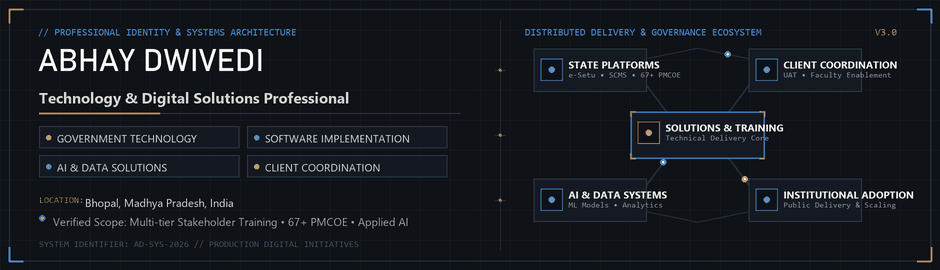

  

&nbsp;

&nbsp;

&nbsp;

  

<code>📍 Bhopal, Madhya Pradesh, India</code>

---

### 📌 About Me

I am a **Technology & Digital Solutions Professional** working across state-level government digital initiatives, software delivery, multi-tier stakeholder coordination, and applied AI/data systems.

Over the past several years, my work has centered on bridging the gap between technical engineering groups, administrative leadership, and operational end users. Rather than viewing technology solely through code, I focus on the entire implementation lifecycle: translating policy mandates into structured technical requirements, managing User Acceptance Testing (UAT), training faculty and staff across regional institutions, and engineering practical machine learning models that support operational decision-making.

---

### 🎯 Focus Areas

* **Government Digital Transformation**  
  Deploying regional public-sector software systems across administrative bodies. Translating government directives into functional system workflows, ensuring audit readiness, and delivering dependable public-facing services.

* **Software Implementation & Client Coordination**  
  Leading institutional rollouts, user acceptance testing (UAT), and stakeholder enablement. Designing technical demonstrations, training faculty and staff, and resolving adoption bottlenecks during software transition.

* **AI, Data Science & Technology Solutions**  
  Developing applied predictive models, data wrangling pipelines, and generative AI/RAG workflows that convert complex operational datasets into clear, actionable intelligence.

---

### 🏛️ Government & Institutional Project Contributions

*The following represent targeted project contributions and coordination mandates delivered for state initiatives and public departments, distinct from direct civil-service employment:*

#### **1. Student & College Management Software (SCMS)** — *Madhya Pradesh Higher Education Department*
* **Role:** Client Coordinator & Technical Trainer
* **Multi-Campus Deployment:** Coordinated software implementation schedules, readiness assessments, and data validation across **67+ PMCOE (Pradhan Mantri College of Excellence) and autonomous colleges**.
* **Stakeholder Coordination:** Served as the operational communication bridge between state department officials, college leadership, registrars, and technical developers.
* **Faculty & Staff Training:** Delivered structured training sessions, workshops, and technical walkthroughs for professors and administrative staff.
* **UAT & Data Validation:** Facilitated User Acceptance Testing cycles, validated legacy academic records, and verified system data consistency.
* **Troubleshooting & Adoption:** Addressed functional issues, gathered end-user feedback, and streamlined onboarding to ensure long-term software adoption.

#### **2. e-Setu** — *Madhya Pradesh Government Agriculture Initiative*
* **Initiative:** State digital platform connecting agricultural communities with governmental services, administrative touchpoints, and logistics.
* **Contribution:** Supported process workflow reviews, system documentation, and functional coordination to ensure accessible, transparent service delivery for rural stakeholders.

#### **3. Directorate of Archaeology, Madhya Pradesh**
* **Initiative:** Heritage documentation and digital onboarding support.
* **Contribution:** Produced technical training videos, visual media walkthroughs, and supporting communication content for departmental staff onboarding and archival workflows.

---

### 💼 Professional Experience

* **Client Coordinator & Technical Trainer — SCMS Project**  
  **Madhya Pradesh Higher Education Department** &nbsp;·&nbsp; *2024 – Present*  
  Coordinated software deployment and data validation across 67+ PMCOE and autonomous colleges. Led faculty training workshops, system demonstrations, and structured UAT cycles while facilitating inter-departmental communication between academic leadership and engineering teams.

* **Software Intern**  
  **CONORG India** &nbsp;·&nbsp; *2024*  
  Contributed to software implementation, core feature development, quality assurance testing, and functional documentation.

* **Python Development Intern**  
  **Codrat Tech Pvt. Ltd.** &nbsp;·&nbsp; *2023 – 2024*  
  Developed automated backend scripts and data processing utilities using Python. Conducted exploratory data analysis (EDA), code optimization, and unit testing routines.

* **Discipline Club Coordinator**  
  **Apna SAC** &nbsp;·&nbsp; *2023 – 2024*  
  Managed student operations and event coordination across 25+ institutional college events. Recognized with the Best Event Management Award.

---

### 🚀 Selected Projects

<!-- START_SECTION:PROJECTS -->
| Project | Focus & Technical Overview | Stack & Links |
| :--- | :--- | :--- |
| **[AI Powered Car Price Prediction](https://github.com/AbhayDw/AI-Powered-Car-Price-Prediction)** | End-to-end regression modeling and feature engineering pipeline to predict pre-owned vehicle valuations with cross-validated evaluation. |  `Python, Scikit-learn` [Repository ↗](https://github.com/AbhayDw/AI-Powered-Car-Price-Prediction) &nbsp;·&nbsp; [Live Demo ↗](https://abhay-portfolio-pi-tan.vercel.app/) |
| **[Emergency Patient Priority Prediction](https://github.com/AbhayDw/Emergency-Patient-Priority-Prediction)** | Clinical triage prioritization system utilizing multi-class predictive classification to assess patient acuity and support hospital admissions. |  `Python, Machine Learning` [Repository ↗](https://github.com/AbhayDw/Emergency-Patient-Priority-Prediction) &nbsp;·&nbsp; [Live Demo ↗](https://abhay-portfolio-pi-tan.vercel.app/) |
| **[Breast Cancer Detection](https://github.com/AbhayDw/Breast-Cancer-Detection)** | Diagnostic classification pipeline evaluating cellular biopsy metrics with precision/recall threshold optimization and ROC-AUC validation. |  `Python, Scikit-learn` [Repository ↗](https://github.com/AbhayDw/Breast-Cancer-Detection) &nbsp;·&nbsp; [Live Demo ↗](https://abhay-portfolio-pi-tan.vercel.app/) |
| **[California Housing Price Prediction](https://github.com/AbhayDw/California-Housing-Price-Prediction)** | Geospatial housing valuation regression model implementing spatial clustering, automated imputation, and hyperparameter tuning. |  `Python, Scikit-learn` [Repository ↗](https://github.com/AbhayDw/California-Housing-Price-Prediction) &nbsp;·&nbsp; [Live Demo ↗](https://abhay-portfolio-pi-tan.vercel.app/) |
<!-- END_SECTION:PROJECTS -->

  <a href="https://github.com/AbhayDw?tab=repositories"><strong>View All Repositories on GitHub ↗</strong></a>

---

### 🛠️ Technical Expertise

| Category | Specialized Toolchain & Applied Competencies | Official Icons |
| :--- | :--- | :---: |
| **Programming & Querying** | `Python`, `SQL` |  |
| **Data Science & Analysis** | `Pandas`, `NumPy`, `Matplotlib`, `Seaborn`, Exploratory Data Analysis (EDA) |  |
| **Machine Learning** | `Scikit-learn`, Linear & Logistic Regression, Multi-class Classification, Feature Engineering, Model Evaluation |  |
| **Artificial Intelligence** | `Generative AI`, `Natural Language Processing (NLP)`, `LangChain`, `Retrieval-Augmented Generation (RAG)` |  &nbsp;  |
| **Databases** | `PostgreSQL`, `MySQL` |  |
| **Analytics & Reporting** | `Power BI`, `Microsoft Excel (Advanced Data Modeling)` |  &nbsp;  |
| **Tools & Workflow** | `Git`, `GitHub`, `GitHub Actions (CI/CD)`, `VS Code`, `Jupyter Notebook` |  |

---

### 📊 GitHub Activity & Statistics

  
  &nbsp;&nbsp;
  

---

### 🏆 Certifications & Achievements

#### Certifications
* **Oracle Agentic AI Certified Foundations Associate** — Oracle
* **Python for Data Science (Score: 75%)** — NPTEL (IIT)
* **Python Essentials 1** — Cisco Networking Academy
* **SQL Intermediate** — HackerRank
* **Data Analyst Master Class** — Professional Specialization

#### Achievements & Leadership
* **First Prize — Gravitation 2024 (Shark Tank Style):** Recognized for technology venture modeling, system viability, and executive presentation.
* **Best Event Management Award:** Commended for operational excellence in coordinating institutional summits and technical conferences.
* **Discipline Club Coordinator (Apna SAC):** Directed student logistics and team coordination across **25+ college events**.
* **Technical Training & Speaking:** Conducted hands-on technical demonstrations and training sessions across institutional workshops and user groups.

---

### 📬 Contact

Feel free to connect regarding **government digital initiatives, software delivery, technical training programs, or applied AI/data solutions**:

* **Email:** [dwivediabhay727@gmail.com](mailto:dwivediabhay727@gmail.com)
* **LinkedIn:** [linkedin.com/in/abhay-dwivedi-6a8aa4279](https://www.linkedin.com/in/abhay-dwivedi-6a8aa4279/)
* **Portfolio:** [abhay-portfolio-pi-tan.vercel.app](https://abhay-portfolio-pi-tan.vercel.app/)
* **GitHub:** [github.com/AbhayDw](https://github.com/AbhayDw)
* **Location:** Bhopal, Madhya Pradesh, India
