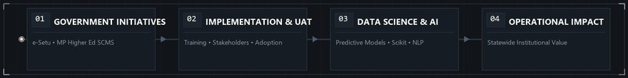
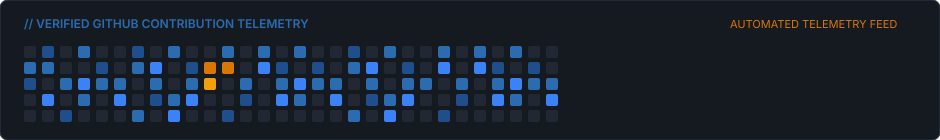

<div align="center">


<br/>

[](https://abhay-portfolio-pi-tan.vercel.app/)
[](https://www.linkedin.com/in/abhay-dwivedi-6a8aa4279/)
[](https://github.com/AbhayDw)
[](mailto:dwivediabhay727@gmail.com)

</div>


### Executive Overview

I am a **Technology & Digital Solutions Professional** working across **state-level government digital platforms, enterprise software implementation, multi-tier stakeholder coordination, and applied AI/data systems**.

My work bridges technical engineering teams with administrative departments, academic leadership, and end users. I focus on the operational reality of software delivery: translating institutional policies into functional technical requirements, managing User Acceptance Testing (UAT), delivering hands-on training to faculty and administrative personnel, and engineering data-driven predictive models that support informed decision-making.

```text
Professional Title:    Technology & Digital Solutions Professional
Core Focus:            Government Platforms • Software Delivery • Stakeholder Training • Applied AI
Headquarters:          Bhopal, Madhya Pradesh, India
Operating Principle:   Robust architectures succeed only when operational adoption is seamless.
```


### Professional Focus Areas

| Focus Area | Operational Scope & Technical Value |
| :--- | :--- |
| **01 &nbsp; Government Digital Transformation** | Deploying public-sector software architectures across regional institutions. Translating governance and policy directives into verifiable functional specifications, maintaining audit integrity, and ensuring reliable delivery for administrative stakeholders. |
| **02 &nbsp; Software Implementation & Client Coordination** | Bridging software engineering teams with institutional administrators. Managing end-to-end rollout schedules, leading User Acceptance Testing (UAT), delivering technical demonstrations, training faculty and administrative staff, and resolving adoption bottlenecks. |
| **03 &nbsp; AI, Data Science & Technology Solutions** | Engineering applied machine learning pipelines, predictive regression and classification engines, exploratory data analyses, and modern agentic/RAG workflows that convert complex operational data into actionable intelligence. |

<br/>

<div align="center">
  
</div>


### Government & Institutional Project Contributions

*The following represent targeted project contributions and coordination mandates delivered for state government initiatives and institutional departments (distinct from direct civil-service employment):*

#### **1. Student & College Management Software (SCMS) — Madhya Pradesh Higher Education Department**
* **Project Role:** Client Coordinator & Technical Trainer
* **Key Contributions & Responsibilities:**
  * **Institutional Implementation Support:** Coordinated software deployment schedules and data readiness across **67+ PMCOE (Pradhan Mantri College of Excellence) and autonomous colleges**.
  * **Department & Stakeholder Coordination:** Acted as primary operational liaison between state higher education officials, college principals, registrars, and technical development teams.
  * **Faculty & Staff Technical Training:** Designed and delivered structured training sessions, practical walkthroughs, and technical demonstrations for professors and administrative staff.
  * **UAT & Data Validation:** Facilitated User Acceptance Testing cycles, validated legacy academic records, and reconciled institutional data structures.
  * **Troubleshooting & Software Adoption:** Monitored real-time user feedback, guided incident resolution workflows, and minimized operational resistance during campus onboarding.

#### **2. e-Setu — Madhya Pradesh Government Agriculture Initiative**
* **Project Scope:** Digital enablement initiative connecting rural agricultural stakeholders with state welfare, administrative validation, and logistics channels.
* **Contribution:** Supported process workflow reviews, system documentation, and functional coordination to ensure smooth accessibility and administrative alignment for ground-level touchpoints.

#### **3. Directorate of Archaeology, Madhya Pradesh**
* **Contribution:** Created structured technical training videos, visual media walkthroughs, and supporting communication materials for departmental digital documentation and staff onboarding.


### Professional Experience Timeline

```text
2024 — PRESENT    MADHYA PRADESH HIGHER EDUCATION DEPARTMENT
                  Client Coordinator & Technical Trainer — SCMS Project
                  • Managed implementation coordination and data validation across 67+ PMCOE & autonomous colleges.
                  • Led technical training sessions, software demonstrations, and structured UAT cycles for faculty/staff.
                  • Streamlined inter-departmental communication between academic leadership and engineering teams.

2024              CONORG INDIA
                  Software Intern
                  • Participated in core software module implementation, code reviews, and quality assurance.
                  • Formulated technical documentation, test cases, and functional workflow diagrams.

2023 — 2024       CODRAT TECH PVT. LTD.
                  Python Development Intern
                  • Engineered automated backend scripts and data processing utilities using Python.
                  • Executed exploratory data analysis (EDA), code optimization, and unit testing routines.

2023 — 2024       APNA SAC
                  Discipline Club Coordinator
                  • Supervised student operations, event logistics, and cross-functional leadership teams.
                  • Coordinated 25+ institutional college events; earned Best Event Management recognition.
```


### Featured Projects

<!-- START_SECTION:PROJECTS -->
| Featured Implementation | Featured Implementation |
| :--- | :--- |
| <strong><a href="https://github.com/AbhayDw/AI-Powered-Car-Price-Prediction">AI Powered Car Price Prediction</a></strong><br/><sub>End-to-end regression modeling and feature engineering pipeline predicting pre-owned vehicle valuations with cross-validated evaluation.</sub><br/><br/><strong>Stack:</strong> <code>Python • Scikit-learn</code><br/><a href="https://github.com/AbhayDw/AI-Powered-Car-Price-Prediction">Inspect Repository ↗</a> &nbsp;•&nbsp; <a href="https://abhay-portfolio-pi-tan.vercel.app/">Live Demo ↗</a> | <strong><a href="https://github.com/AbhayDw/Emergency-Patient-Priority-Prediction">Emergency Patient Priority Prediction</a></strong><br/><sub>Clinical triage prioritization system utilizing multi-class predictive modeling to categorize patient acuity and assist hospital admissions.</sub><br/><br/><strong>Stack:</strong> <code>Python • ML</code><br/><a href="https://github.com/AbhayDw/Emergency-Patient-Priority-Prediction">Inspect Repository ↗</a> &nbsp;•&nbsp; <a href="https://abhay-portfolio-pi-tan.vercel.app/">Live Demo ↗</a> |
| <strong><a href="https://github.com/AbhayDw/Breast-Cancer-Detection">Breast Cancer Detection</a></strong><br/><sub>Diagnostic classification pipeline evaluating cellular biopsy metrics with precision/recall threshold optimization and ROC-AUC validation.</sub><br/><br/><strong>Stack:</strong> <code>Python • Scikit-learn</code><br/><a href="https://github.com/AbhayDw/Breast-Cancer-Detection">Inspect Repository ↗</a> &nbsp;•&nbsp; <a href="https://abhay-portfolio-pi-tan.vercel.app/">Live Demo ↗</a> | <strong><a href="https://github.com/AbhayDw/California-Housing-Price-Prediction">California Housing Price Prediction</a></strong><br/><sub>Geospatial housing valuation regression model implementing spatial clustering, automated imputation, and hyperparameter tuning.</sub><br/><br/><strong>Stack:</strong> <code>Python • Scikit-learn</code><br/><a href="https://github.com/AbhayDw/California-Housing-Price-Prediction">Inspect Repository ↗</a> &nbsp;•&nbsp; <a href="https://abhay-portfolio-pi-tan.vercel.app/">Live Demo ↗</a> |
| <strong><a href="https://github.com/AbhayDw/Titanic-Survival-Prediction">Titanic Survival Prediction</a></strong><br/><sub>Exploratory data analysis (EDA), probabilistic feature engineering, and ensemble classification on demographic survival factors.</sub><br/><br/><strong>Stack:</strong> <code>Python • Pandas • ML</code><br/><a href="https://github.com/AbhayDw/Titanic-Survival-Prediction">Inspect Repository ↗</a> &nbsp;•&nbsp; <a href="https://abhay-portfolio-pi-tan.vercel.app/">Live Demo ↗</a> | <strong><a href="https://github.com/AbhayDw/Movie-Recommendation-System">Movie Recommendation System</a></strong><br/><sub>Hybrid content-based recommendation engine utilizing cosine similarity matrices and high-dimensional vector representations.</sub><br/><br/><strong>Stack:</strong> <code>Python • NLP • Vectors</code><br/><a href="https://github.com/AbhayDw/Movie-Recommendation-System">Inspect Repository ↗</a> &nbsp;•&nbsp; <a href="https://abhay-portfolio-pi-tan.vercel.app/">Live Demo ↗</a> |
<!-- END_SECTION:PROJECTS -->

<p align="right">
  <strong><a href="https://github.com/AbhayDw?tab=repositories">Explore All Public Repositories ↗</a></strong>
</p>

> *The project matrix above updates automatically via a GitHub Actions synchronization workflow that tracks repositories tagged with the topic `portfolio`.*


### Technical Expertise

| Category | Specialized Toolchain & Applied Competencies |
| :--- | :--- |
| **Programming & Querying** | `Python`, `SQL (Structured Query Language)`, `Shell Scripting` |
| **Data Science & Wrangling** | `Pandas`, `NumPy`, `Matplotlib`, `Seaborn`, Exploratory Data Analysis (EDA) |
| **Machine Learning** | `Scikit-learn`, Linear/Logistic Regression, Multi-class Classification, Feature Engineering, Cross-Validation, Model Evaluation |
| **Artificial Intelligence** | `Generative AI Foundations`, `Natural Language Processing (NLP)`, `LangChain`, `Retrieval-Augmented Generation (RAG)` |
| **Databases & Architecture** | `MySQL`, `PostgreSQL`, Relational Schema Design, Query Optimization |
| **Analytics & BI** | `Power BI`, `Microsoft Excel (Advanced Data Modeling)`, Metric Synthesis, KPI Dashboards |
| **Tools & Environments** | `Git`, `GitHub`, `GitHub Actions (CI/CD)`, `VS Code`, `Jupyter Notebook`, UAT Protocols |


### Verified Certifications & Honors

#### Professional Certifications
* **Oracle Certified Associate** — Oracle Agentic AI Certified Foundations Associate
* **NPTEL (IIT)** — Python for Data Science *(Score: 75%)*
* **Cisco Networking Academy** — Cisco Python Essentials 1
* **HackerRank** — SQL Intermediate Certified Assessment
* **Industry Specialization** — Data Analyst Master Class

#### Leadership & Honors
* 🏆 **First Prize — Gravitation 2024 (Shark Tank Style)**: Commended for tech-venture business modeling, system feasibility, and executive presentation.
* 🎖️ **Best Event Management Award**: Recognized for outstanding leadership in orchestrating institutional summits and tech assemblies.
* 👥 **Discipline Club Coordinator (Apna SAC)**: Successfully directed coordination across **25+ college events** and campus student initiatives.
* 🎙️ **Technical Training & Speaking**: Facilitated technical demonstrations and onboarding workshops for institutional staff and student communities.


### GitHub Activity & Telemetry

<div align="center">
  
</div>

* **Statewide Implementations:** Government and departmental systems operate within dedicated institutional infrastructure governed by statutory compliance and security requirements.
* **Public Engineering:** Open-source repositories focus on applied machine learning, predictive analytics, automated utilities, and reproducible data science pipelines.
* **Autonomous Maintenance:** This profile's showcased projects and telemetry are maintained through scheduled Python automation scripts running on GitHub Actions.


### Professional Inquiries & Connect

I welcome conversations regarding **statewide digital transformation initiatives, enterprise software rollouts, technical training engagements, and applied AI/data solutions**.

<p align="left">
  <a href="mailto:dwivediabhay727@gmail.com">
    
  </a>
  &nbsp;
  <a href="https://www.linkedin.com/in/abhay-dwivedi-6a8aa4279/">
    
  </a>
  &nbsp;
  <a href="https://abhay-portfolio-pi-tan.vercel.app/">
    
  </a>
  &nbsp;
  <a href="https://github.com/AbhayDw">
    
  </a>
</p>

```text
Location:       Bhopal, Madhya Pradesh, India
Timezone:       IST (UTC +5:30)
Official Email: dwivediabhay727@gmail.com
```

<div align="center">
  <sub>Engineered with an editorial aesthetic for Abhay Dwivedi • Synchronized via GitHub Actions</sub>
</div>
